<div align="center">


# ImprintSites AI

### Imagine it. Build it. Launch it.

**A no-code website builder for personal portfolios, businesses and online stores.**<br />
Describe the website you need, preview it on every device, refine it in a live editor, and publish it to its own web address, all running on Cloudflare's edge.

[**Live site**](https://imprintsites.omodingisaac123.workers.dev) ·
[Portfolio demo](https://imprintsites.omodingisaac123.workers.dev/s/demo-portfolio/) ·
[Business demo](https://imprintsites.omodingisaac123.workers.dev/s/demo-business/) ·
[Store demo](https://imprintsites.omodingisaac123.workers.dev/s/demo-store/)


<sub>A product of Motion Imprints Technologies</sub>

</div>

<br />

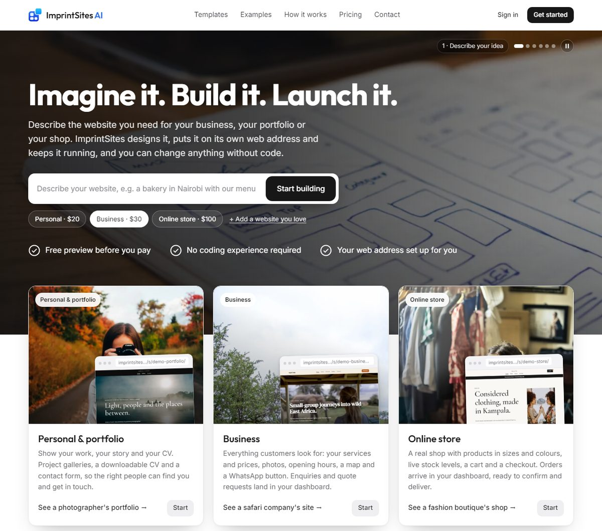

---

## Contents

- [Overview](#overview)
- [Screenshots](#screenshots)
- [Features](#features)
- [Pricing model](#pricing-model)
- [Architecture](#architecture)
- [Tech stack](#tech-stack)
- [Project structure](#project-structure)
- [Getting started](#getting-started)
- [Configuration](#configuration)
- [Testing](#testing)
- [Deployment](#deployment)
- [Operations](#operations)
- [Security](#security)
- [Status and roadmap](#status-and-roadmap)
- [Documentation](#documentation)
- [Credits and licensing](#credits-and-licensing)

---

## Overview

ImprintSites AI turns a plain-language description into a polished, mobile-ready website, then lets its owner keep it up to date without writing code. It sells three kinds of site:

| Product | What the customer gets | Build fee |
|---|---|---:|
| **Personal & portfolio** | About, experience, projects with galleries, downloadable CV, contact form | **$20** |
| **Business** | Multi-page site with services, gallery, map, opening hours, WhatsApp, contact and quote forms | **$30** |
| **Online store** | Product catalogue with variants and stock, search and filters, cart, checkout, orders dashboard | **$100** |

Every published site also has **hosting & maintenance at $4 per site per month**.

**How a site is made:**

1. A **guided wizard** collects the customer's content. Answers save automatically, and the store flow is the most detailed of the three.
2. The customer picks one of **18 original templates**, or **pastes a website they love**. The platform reads that site's high-level style (palette, type, spacing, shapes, layout rhythm) and applies it to an original design. Nothing is copied.
3. A **deterministic generator** builds a strictly validated site document from the answers. Optional **Workers AI** can polish the wording, but it never adds facts, and the owner reviews every suggestion.
4. The **editor** shows the real site at desktop, tablet and mobile sizes, with sections, theme controls, undo/redo, checkpoints, template switching, and plain-English design requests ("make it more elegant", "dark mode").
5. The customer **picks a web address** (availability-checked, set up automatically with HTTPS), pays the one-time build fee, and the site goes live with version history and rollback.

---

## Screenshots

<table>
<tr>
<td width="50%"><br /><sub><b>What you can build</b>: each kind of site shown with the real demo it produces</sub></td>
<td width="50%">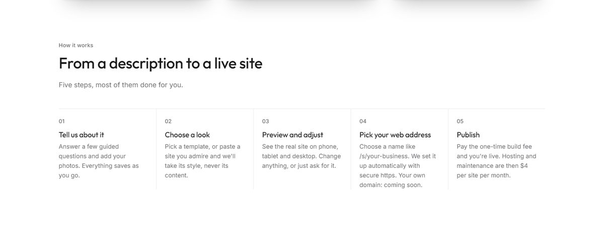<br /><sub><b>How it works</b>: five steps, including picking a web address</sub></td>
</tr>
</table>

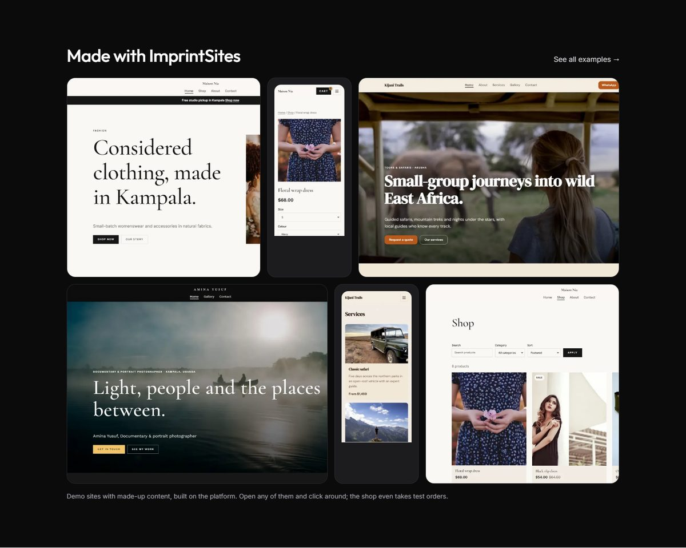
<sub><b>Made with ImprintSites</b>: real demo sites running on the platform</sub>

<table>
<tr>
<td width="33%"><br /><sub><b>Store demo</b>: Maison template</sub></td>
<td width="33%"><br /><sub><b>Business demo</b>: Savanna template</sub></td>
<td width="33%"><br /><sub><b>Portfolio demo</b>: Lens template</sub></td>
</tr>
</table>

<table>
<tr>
<td width="50%">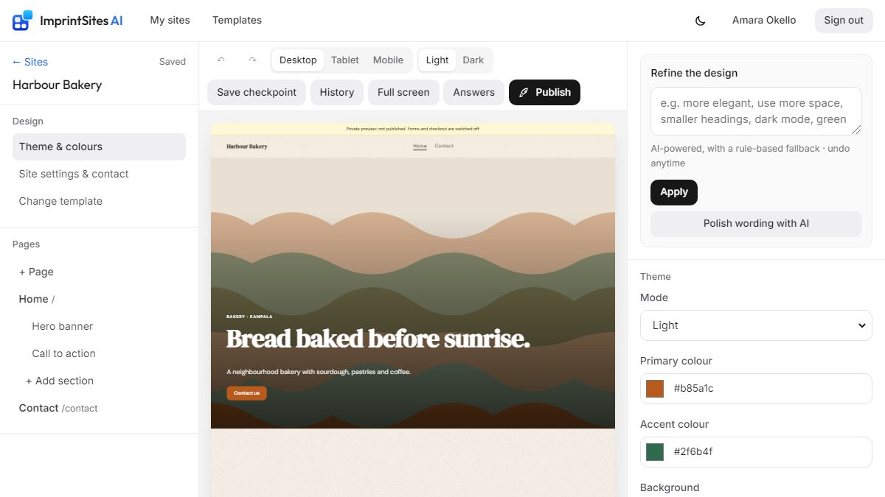<br /><sub><b>Editor</b>: pages, sections, theme and live preview</sub></td>
<td width="50%">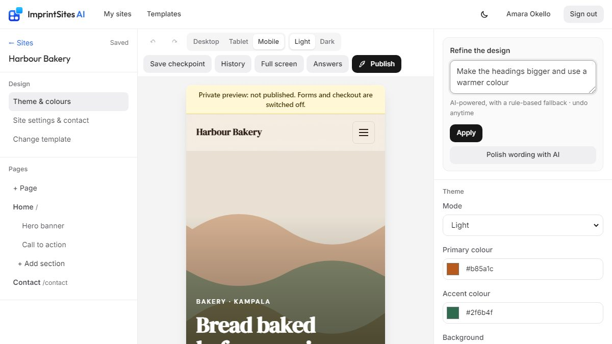<br /><sub><b>Refine with AI</b>: plain-English design changes, previewed on mobile</sub></td>
</tr>
<tr>
<td width="50%">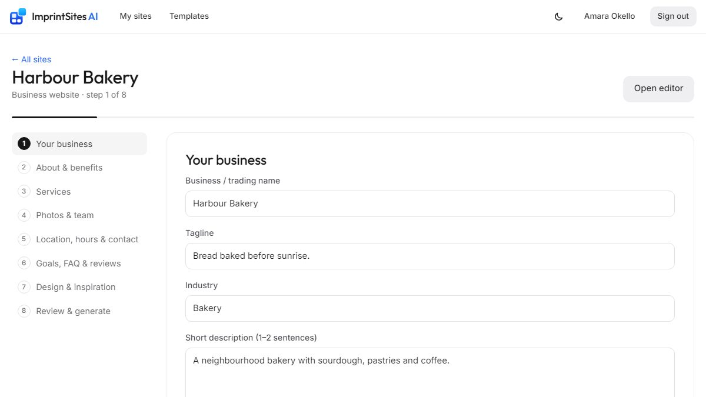<br /><sub><b>Guided wizard</b>: autosaving, step-by-step intake</sub></td>
<td width="50%">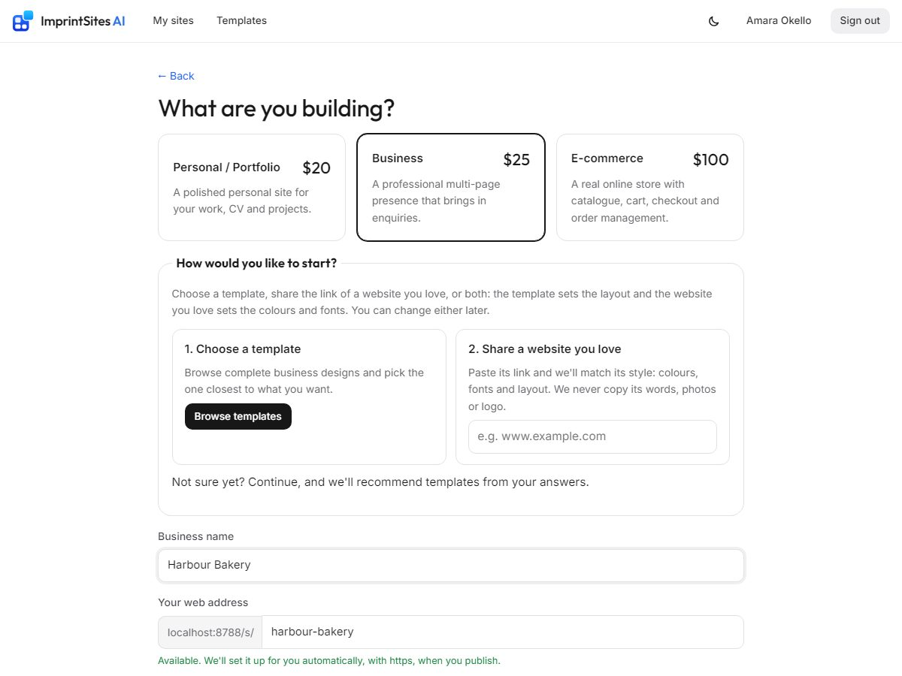<br /><sub><b>Web address picker</b>: live availability check and automatic alternatives</sub></td>
</tr>
<tr>
<td width="50%">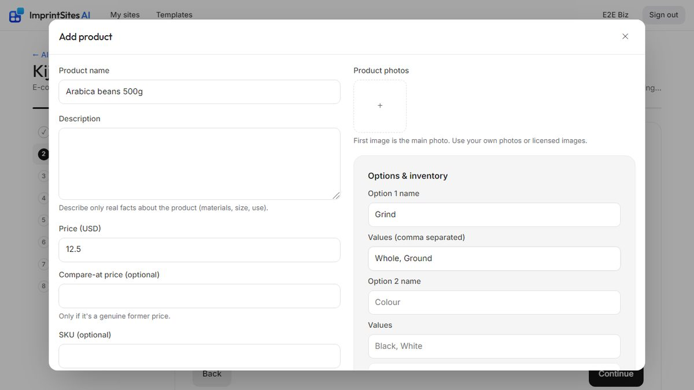<br /><sub><b>Product editor</b>: variants, stock, categories and photos</sub></td>
<td width="50%">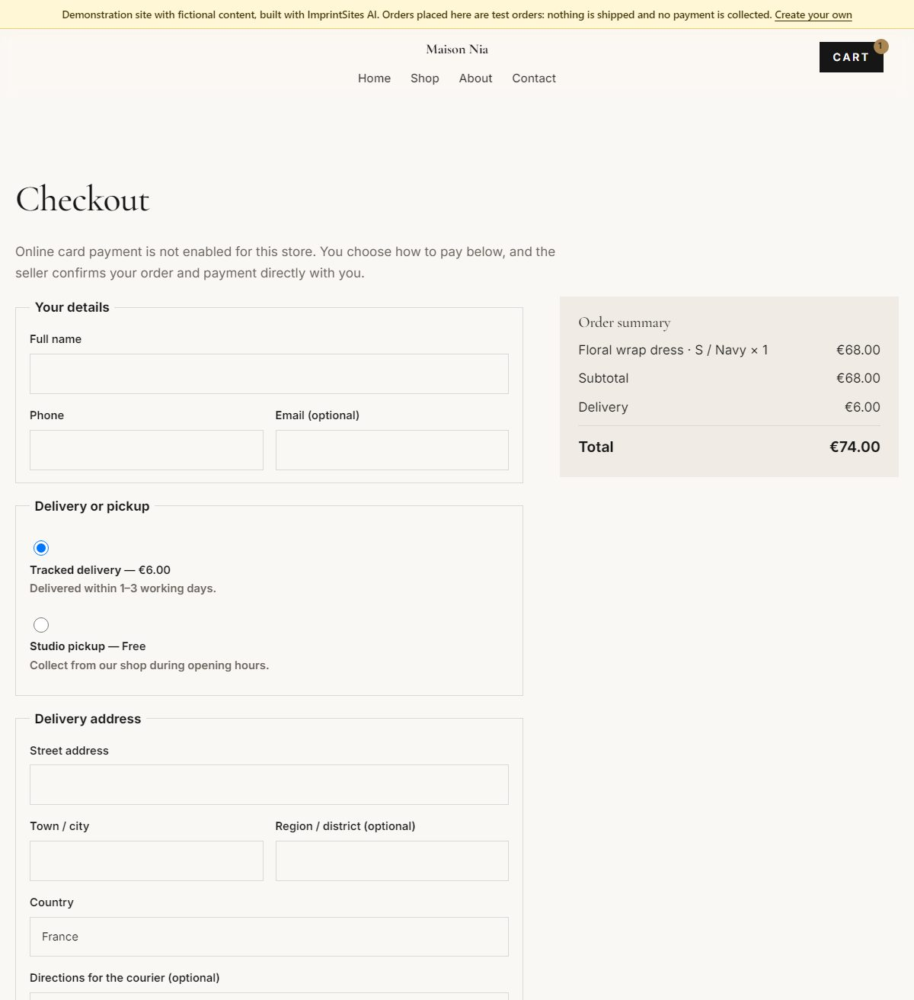<br /><sub><b>Store checkout</b>: server-priced totals and delivery options</sub></td>
</tr>
<tr>
<td width="50%">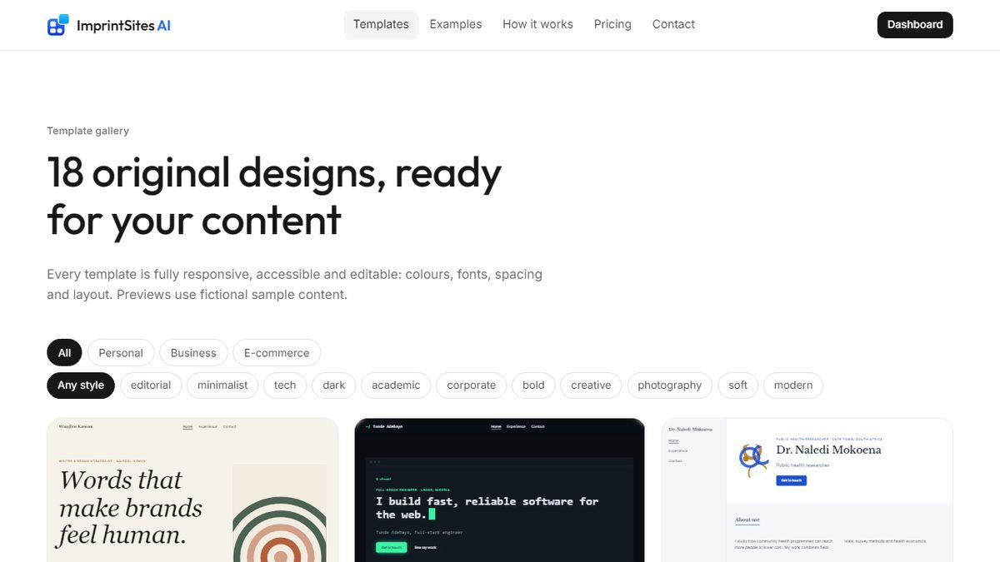<br /><sub><b>Template gallery</b>: 18 templates, 9 unlocked by signing in</sub></td>
<td width="50%">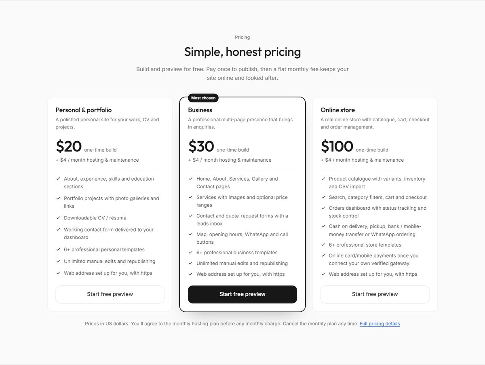<br /><sub><b>Pricing</b>: one-time build fee plus $4/month hosting & maintenance</sub></td>
</tr>
</table>

---

## Features

### Marketing site
- Photographic hero with a rotating slideshow of the website-building journey: dot controls, a pause button, and no rotation for visitors who prefer reduced motion.
- A prompt-first start: describe your site, pick a type, optionally paste a website you love.
- Pages: pricing, template gallery with filters, live examples, how-it-works, contact and support form, Terms, Privacy, Refund & Cancellation.

### Builder
- **Three intake wizards** with autosave, repeatable lists (experience, projects, services, team, FAQs), media library, CSV/PDF uploads and Openverse photos with licence and attribution recorded.
- **18 templates** (6 personal, 6 business, 6 e-commerce), each structurally distinct: editorial, terminal, sidebar, poster, full-bleed, mosaic, menu-style and more.
- **Inspiration from a link:** Cloudflare Browser Run renders the page and extracts computed styles, with an HTML/CSS fallback and a screenshot-upload fallback. The result is a structured style brief with recommended templates.
- **Editor:** page and section management, inspector forms for 21 section types, theme tokens (colours, fonts, radius, density, motion), undo/redo, checkpoints, template switching, click-to-select in the preview, and true-size device previews.
- **AI refinement:** design requests become validated token patches. Workers AI (`llama-3.3-70b-instruct-fp8-fast`, JSON mode) is used when available, with a deterministic rule-based fallback that is labelled as such.

### Publishing
- Path-based sites at `/s/<your-address>/`, with addresses checked for availability, reserved names blocked, and free alternatives suggested automatically.
- Immutable published versions, one-click rollback, unpublish, signed 7-day private preview links, and a static ZIP export (HTML, assets and `site.json`).
- Customer sites are server-rendered HTML/CSS with a strict nonce-based Content Security Policy. The only script is the platform's own runtime.

### Online stores
- Products, variants (two option axes), stock tracking, backorders, max-per-order limits, categories, and CSV import with column mapping and per-row validation.
- Server-rendered search, category filters and sorting; product pages with variant pickers; cart; checkout.
- Orders: totals computed server-side, idempotent submission, **atomic oversell protection** (a D1 trigger aborts any batch that would push stock below zero), status workflow, restocking on cancellation, CSV export.
- Seller-controlled payment methods (pay on delivery, pay on pickup, bank transfer, mobile wallet, WhatsApp) and delivery or pickup options with fees.

### Accounts and admin
- Email/password accounts (PBKDF2-SHA256), sessions in HttpOnly cookies, CSRF protection, rate limiting, password reset, data export and deletion requests.
- Google sign-in (OAuth 2.0 with PKCE and safe account linking), active once a client ID is configured.
- Role-based admin console: overview metrics, users, projects (audited demo entitlements and suspensions), support tickets, payments and webhooks, orders, settings (including the hosting fee), and a full audit log.

### Billing (the platform's own service)
- Dodo Payments checkout for the build fees, with prices read from server-side constants.
- Standard Webhooks signature verification, idempotency by webhook ID, re-fetch of the payment from the provider before any entitlement is granted, refund handling, and separation of test and live modes.

---

## Pricing model

| | Personal & portfolio | Business | Online store |
|---|---:|---:|---:|
| **Build fee (one-time)** | $20 | $30 | $100 |
| **Hosting & maintenance** | $4 / month | $4 / month | $4 / month |

- **Build fees** are locked in [`src/shared/pricing.ts`](src/shared/pricing.ts) and are never accepted from the client.
- **Hosting & maintenance** is stored in `system_settings` and can be changed in the admin console. Monthly billing is not live yet; customers are told they'll agree to the plan before any monthly charge.
- **Store revenue** belongs to each seller and never passes through the platform's payment account.

Full details: [PRICING_AND_BILLING.md](PRICING_AND_BILLING.md).

---

## Architecture

The whole product runs as **one Cloudflare Worker**: a Hono API, a server-side site renderer, and a React SPA served as static assets.

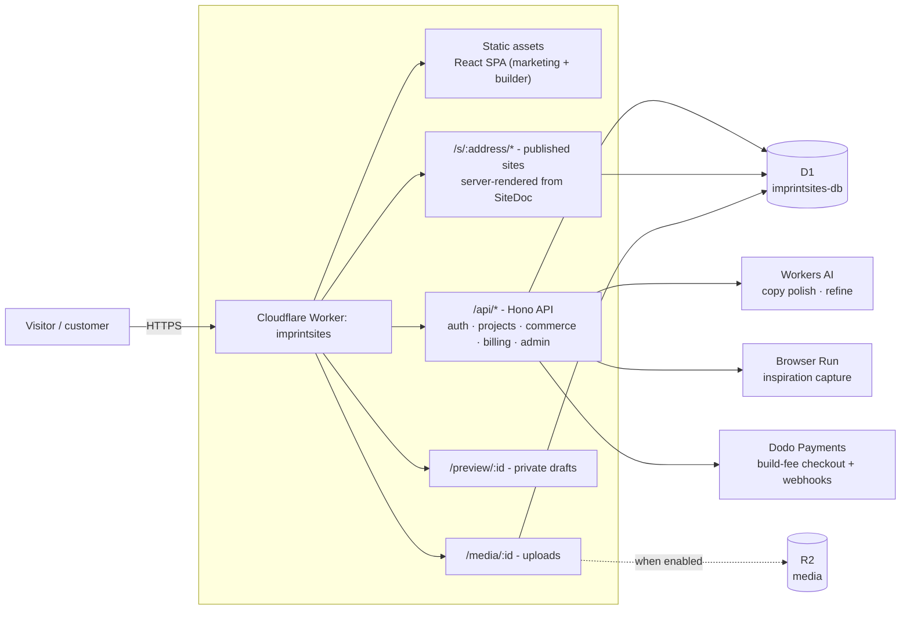

**Key ideas**

- **SiteDoc:** every website is one strictly validated JSON document ([`src/shared/schema.ts`](src/shared/schema.ts)). The wizard, AI, editor and refine engine all produce SiteDocs, and only the platform renderer turns them into HTML, so no user or model code ever runs on a customer site.
- **Shared rendering:** [`src/shared/render/`](src/shared/render/) is used both by the Worker (published sites, previews, exports) and by the tests.
- **Truthful by design:** features that aren't configured (payments, Google sign-in, email, custom domains) say so in the UI instead of pretending.

More detail: [docs/architecture.md](docs/architecture.md).

---

## Tech stack

| Layer | Technology |
|---|---|
| Runtime and hosting | Cloudflare Workers with static assets (`@cloudflare/vite-plugin`) |
| API | [Hono](https://hono.dev), Zod validation |
| Frontend | React 19, React Router, hand-written CSS design system (Outfit and Inter) |
| Data | Cloudflare D1 (SQLite), with R2 for media once enabled |
| AI | Workers AI (`@cf/meta/llama-3.3-70b-instruct-fp8-fast`, JSON mode) |
| Headless browser | Cloudflare Browser Run (`@cloudflare/puppeteer`) |
| Payments | Dodo Payments (Standard Webhooks) |
| Testing | Vitest (unit and integration), Playwright with axe-core (end-to-end and accessibility) |
| Language | TypeScript (strict) |
| Python backend (migration in progress) | Django 6, Django REST Framework, PostgreSQL on Neon. It serves the project read path today; see [backend/README.md](backend/README.md) |
| Shared contracts | `contracts/`: SiteDoc JSON Schema, public config and a fixture corpus, all generated from the TypeScript source and validated in both languages |

---

## Project structure

```
.
├── src/
│   ├── shared/              # Used by Worker and tests
│   │   ├── schema.ts        # SiteDoc schema (Zod)
│   │   ├── pricing.ts       # Locked build fees
│   │   ├── templates.ts     # 18 template definitions
│   │   ├── generate.ts      # Wizard answers -> SiteDoc (never invents facts)
│   │   ├── refine.ts        # Design patches + rule-based refine engine
│   │   ├── demo.ts          # Demo personas and public demo sites
│   │   └── render/          # HTML/CSS renderer, storefront pages, platform runtime JS
│   ├── worker/
│   │   ├── index.ts         # Hono app, security headers, cron
│   │   ├── routes/          # auth, projects, assets, commerce, public, billing, admin, sites
│   │   ├── lib/             # auth, crypto, storage (R2/D1), ssrf, ai, dodo, inspiration, zip, email
│   │   └── seed.ts          # Idempotent demo-site seeding
│   └── client/              # React SPA
│       ├── pages/           # Home, marketing, auth, legal
│       ├── app/             # Dashboard, wizard, editor, store manager, publish, admin
│       └── components/      # UI kit, spec-driven forms, media library
├── migrations/              # D1 schema and settings migrations
├── public/                  # Logo, hero photos, demo photos (CC0), showcase screenshots
├── tests/
│   ├── unit/                # Renderer (all templates), security, pricing, webhooks
│   ├── integration/         # API tests against a running Worker
│   └── e2e/                 # Playwright browser flows + accessibility
├── scripts/                 # Production smoke test, admin bootstrap, showcase capture, cleanup SQL
└── docs/                    # Architecture, setup, costs, Dodo, domains, QA, screenshots
```

---

## Getting started

### Prerequisites
- Node.js 20 or newer (developed on Node 24)
- A Cloudflare account, with Wrangler logged in (`npx wrangler login`) for AI and Browser Run during local preview
- Google Chrome (Playwright uses the installed channel)

### Install and run locally

```bash
npm install
cp .dev.vars.example .dev.vars          # set SESSION_SECRET to a long random string
npm run db:migrate:local                # create the local D1 schema
npm run build
npx vite preview --port 8788 --strictPort
```

Open http://localhost:8788. The demo sites are created automatically on first visit. For hot-reloading development, use `npm run dev`.

> **Note:** restart `vite preview` after every `npm run build`, because it serves the built `dist/` folder.

---

## Configuration

**Bindings** (in `wrangler.jsonc`)

| Binding | Resource | Purpose |
|---|---|---|
| `DB` | D1 `imprintsites-db` | All application data |
| `AI` | Workers AI | Copy polish and design refinement |
| `BROWSER` | Browser Run | Rendering inspiration websites |
| `ASSETS` | Static assets | React SPA and images |
| `MEDIA` | R2 `imprintsites-media` | Uploads (commented out until R2 is enabled) |

**Variables:** `APP_NAME`, `APP_ENV`, `PAYMENTS_MODE` (`test` or `live`), `AI_MODEL`.

**Secrets** (set with `npx wrangler secret put <NAME>`, or in `.dev.vars` locally; never commit them)

| Secret | Required | Purpose |
|---|---|---|
| `SESSION_SECRET` | Yes | Signs preview links and order tokens; salts IP hashes |
| `ADMIN_EMAILS` | Optional | Google-verified emails that get admin access |
| `GOOGLE_CLIENT_ID`, `GOOGLE_CLIENT_SECRET` | Optional | Google sign-in |
| `DODO_API_KEY`, `DODO_WEBHOOK_SECRET` | For payments | Dodo checkout and webhook verification |
| `DODO_PRODUCT_PERSONAL`, `DODO_PRODUCT_BUSINESS`, `DODO_PRODUCT_ECOMMERCE` | For payments | Dodo product IDs for the three build fees |
| `RESEND_API_KEY`, `EMAIL_FROM` | Optional | Transactional email |
| `PUBLIC_BASE_URL` | Optional | Canonical base URL (defaults to the request host) |

Step-by-step owner setup: [docs/cloudflare-setup.md](docs/cloudflare-setup.md).

---

## Testing

| Suite | Command | What it covers |
|---|---|---|
| **Unit** (64) | `npm run test:unit` | All 18 templates render every page; HTML escaping and link sanitising; no invented content; locked pricing; SSRF URL checks; webhook signatures; password hashing; upload type sniffing; CSV parsing; WCAG contrast of template palettes |
| **Integration** (49, +3 parity) | `npm run test:integration` | Against a running Worker: auth and CSRF, private previews, payment-gated publishing, versions and rollback, leads, tenant isolation, upload security, SSRF, checkout, concurrent orders that can't oversell, exactly-once restocking, web-address picker, webhook verification |
| **End-to-end** (11) | `npx playwright test` | Real browser flows with axe-core accessibility checks and console-error checks: marketing pages, demo sites on desktop and mobile, full store purchase, sign-up → wizard → editor → publish gate, all 18 templates; saves screenshots |
| **Merchant regressions** (13, part of integration) | `npx vitest run -c vitest.integration.config.ts tests/integration/merchant-regressions.test.ts` | Audit findings #1–#3: store currency from setup is used for products, quotes, orders and publishing; CSV re-import keeps variants and stock; editing after a sale never reverses it |
| **Python backend** (52) | `cd backend && .venv/Scripts/python -m pytest` | Contracts, legacy session auth, project read shape and errors, D1 → PostgreSQL importer. Worker ↔ Python parity and a browser test are documented in [backend/README.md](backend/README.md) |
| **Production smoke** (36) | `node scripts/smoke-prod.mjs <url>` | Live checks, including real Workers AI and Browser Run calls; cleans up after itself |

Integration and end-to-end tests read `TEST_BASE_URL` (default `http://localhost:8788`), so the same suites run against production:

```bash
TEST_BASE_URL=https://imprintsites.omodingisaac123.workers.dev npx playwright test
```

After any test run against production, remove the test data:

```bash
npx wrangler d1 execute DB --remote --file scripts/cleanup-test-data.sql --yes
```

---

## Deployment

```bash
npm run typecheck
npm run build
npm run db:migrate:remote
npx wrangler deploy
node scripts/smoke-prod.mjs https://imprintsites.omodingisaac123.workers.dev
```

The release checklist is in [docs/quality-checklist.md](docs/quality-checklist.md), and deploy history with verification evidence is in [DEPLOYMENT_REPORT.md](DEPLOYMENT_REPORT.md). To roll back the Worker, run `npx wrangler rollback`. Customer sites have their own per-site version rollback in the product.

---

## Operations

- **Make yourself admin:** sign up on the site, then run `node scripts/make-admin.mjs you@example.com`.
- **Demo sites** are seeded lazily from [`src/shared/demo.ts`](src/shared/demo.ts). Bump `SEED_VERSION` in [`src/worker/seed.ts`](src/worker/seed.ts) to regenerate them after changing personas.
- **Showcase screenshots** for the home page come from `node scripts/make-showcase.mjs <url>`. Re-run it after visual changes to the demos, then rebuild.
- **Hosting fee and operator details** are edited in Admin → Settings and shown on every page that mentions them.
- **Daily cron** (`17 3 * * *`) cleans up expired sessions, old rate-limit windows, used reset tokens and old error logs.

---

## Security

- **Tenant isolation:** every project-scoped query checks ownership. Cross-tenant access returns 404.
- **Customer sites:** escaped output, an allow-list for links, a strict nonce-based CSP, and no user or AI-supplied scripts.
- **Uploads:** file types are detected from their contents, not their names; SVG and HTML are rejected; size limits and per-project quotas apply; media is served with `nosniff` and a sandbox CSP.
- **SSRF protection** for inspiration and image imports: private, loopback, link-local and metadata addresses are blocked; DNS answers are checked; redirects are re-validated; timeouts and byte caps apply.
- **Accounts:** PBKDF2 password hashing, HttpOnly SameSite cookies, CSRF header plus Origin checks, and database-backed rate limits.
- **Payments:** verified webhooks, idempotent processing, and server-side amount checks. A browser redirect never unlocks publishing.

Full threat model and residual risks: [SECURITY_NOTES.md](SECURITY_NOTES.md).

---

## Status and roadmap

**Live and tested:** marketing site, accounts, wizards, generator, 18 templates, inspiration analysis, editor with AI refine, publishing with versions and rollback, web-address picker, stores with orders and stock control, leads, admin console, billing code.

**Waiting on account setup:**

| Item | Status |
|---|---|
| Workers Paid plan | Upgrade pending (the code is sized for Paid limits) |
| R2 media storage | Not enabled yet; uploads use D1 storage until then |
| Google sign-in | Needs an OAuth client ID and secret |
| Dodo Payments | Needs test-mode keys, products and a webhook |
| Email notifications | Needs a Resend key |

**Next on the roadmap:**

1. **Monthly hosting billing:** a Dodo subscription for the $4/month plan, with explicit opt-in.
2. **Custom domains:** an owned zone plus Cloudflare for SaaS custom hostnames ([docs/domain-publishing.md](docs/domain-publishing.md)).
3. **Seller card payments:** each store connects its own gateway (Flutterwave, Paystack or Pesapal).
4. Turnstile on public forms, edge caching for published pages, and prerendered marketing pages for SEO.

Detailed checklist: [BUILD_STATUS.md](BUILD_STATUS.md).

---

## Documentation

| Document | Contents |
|---|---|
| [AGENTS.md](AGENTS.md) | Handoff guide for coding agents: rules, conventions, release procedure, environment quirks |
| [BUILD_STATUS.md](BUILD_STATUS.md) | Feature checklist, test results, fixed defects, priorities |
| [DEPLOYMENT_REPORT.md](DEPLOYMENT_REPORT.md) | Deployments, bindings and production verification evidence |
| [PRICING_AND_BILLING.md](PRICING_AND_BILLING.md) | Locked pricing, hosting fee, Dodo flow, marketplace segregation |
| [SECURITY_NOTES.md](SECURITY_NOTES.md) | Trust boundaries, controls, residual risks |
| [docs/architecture.md](docs/architecture.md) | System design and data model |
| [docs/cloudflare-setup.md](docs/cloudflare-setup.md) | Owner setup steps (Paid plan, R2, Google, Dodo, email) |
| [docs/dodo-integration.md](docs/dodo-integration.md) | Payments integration and onboarding checklist |
| [docs/domain-publishing.md](docs/domain-publishing.md) | Path-based publishing today; custom domains next |
| [docs/operating-costs.md](docs/operating-costs.md) | Cost model at 100, 1,000 and 10,000 customers |
| [docs/quality-checklist.md](docs/quality-checklist.md) | Release checklist |

---

## Credits and licensing

- **Photography:** all hero and demo-site photos are **CC0 1.0** (public domain) from StockSnap via Openverse. Per-image credits are in [`public/hero/CREDITS.txt`](public/hero/CREDITS.txt) and [`public/stock/CREDITS.txt`](public/stock/CREDITS.txt).
- **Fonts:** Outfit, Inter and the template typefaces are served by Google Fonts under the SIL Open Font License.
- **Demo content** (people, businesses, products and orders) is fictional and labelled as such wherever it appears.

**License:** no open-source license has been granted. © Motion Imprints Technologies. All rights reserved.
